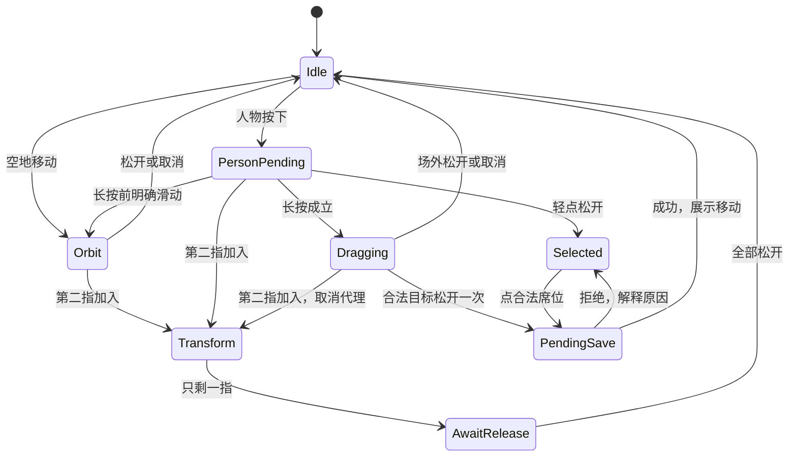
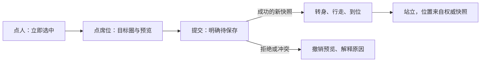

# iPhone Safari 球馆交互设计与研究

日期：2026-10-30。代码基线：`06177a6`。本次范围为现有 P2/P6 交互的研究、方案与验收设计，未实现或发布新交互。本次开始时工作区与暂存区干净。

用户最新反馈：**旋转不跟手，起步或松手不自然**。未来要增加人物移动动画，因此先确定稳定的输入方式。下述参数与改进是设计建议，不自动替代已确认需求；现有业务、权限与数据以 [需求](requirements.md)、[venue 契约](../../src/modules/venue/README.md) 为准。

## 1. 推荐方向

采用适合微缩场馆的直接操控：**单指转动球馆，双指缩放和平移，点人物再点位置完成排阵，长按拖动作为快捷方式**。保留单手可以完成的核心操作，不增加常驻摇杆、双指扭转或复杂组合手势。

优秀手感的顺序是：动作可预测 → 首帧及时 → 连续反向 → 松手准确 → 反馈清楚 → 动画表现。当前先修可复现的控制问题，再用真机数据调增益；不要用大阻尼掩盖输入延迟。

这是针对本项目的选择，并非“所有 iPhone 3D 应用唯一最佳手势”。用户已确认单指旋转；Three.js 官方的 OrbitControls 也采用单指旋转、双指缩放和平移作为触摸默认。成熟映射仍需项目级仲裁与调校。[Three.js 官方文档](https://threejs.org/docs/pages/OrbitControls.html)

## 2. 当前页面与代码证据

### 本次页面检查

环境：Windows Codex 内置浏览器，线上现有页面，390×844 CSS px。仅观察及操作镜头；没有提交阵容、开赛、比分或其他共享变更。**这不是 iPhone Safari，也不能测出真机触摸延迟。**

1. **进入竖屏总览：场馆主导画面，角色与姓名对应明确。** 已有 44px 姓名触区与场内记分牌；画面窄，人物、牌面和空地相邻，起手位置的判定很重要。图 01 可见 2 号牌邻近人物姓名，需关注旋转后的遮挡和热区重叠。
2. **在左侧空地水平拖动约 82px：旋转可用。** yaw 从 `0.071` 到 `-0.325`，pitch 保持 `0.707`，实际 zoom 为 `20.74468085106383`，松手后 `cameraMoving=false`，记录 revision 为 15。图 02 中场馆靠近左右边界；恢复全景入口有价值，但手势中不能为了塞回全景而自动缩放。

截图是本次捕获并检查的原文件，存于被忽略的 `outputs/`，仅在此工作区可用，不是已提交的长期附件。

| 图 01：竖屏总览 | 图 02：空地旋转后 |
| --- | --- |
|  |  |

截图可以检查构图、可达性和状态，不能证明点击精度、VoiceOver 完整可用、帧率或 iPhone 手感达标。正式业务写入流程不在本次页面检查范围内。

### 已确定的控制问题：到达俯仰边界后，反向存在空行程

实际 [orbitNavigation](../../src/modules/venue/world.ts) 用起手姿态加累计位移计算角度，再限制到 32–72°；[InteractiveVenue](../../src/modules/venue/InteractiveVenue.tsx) 在这一手势内仍使用原起点。因此超出边界的位移必须先反向走回来，镜头才重新变化。

直接导入当前函数运行的结果如下。`dy` 是相对按下位置的累计 CSS 像素：

| 同一根手指的轨迹 | 实际俯仰 | 感受 |
| --- | ---: | --- |
| 起点 0px | 40.529° | 正常 |
| 向下 31px | 32° | 到下限 |
| 继续到 100px | 32° | 已达边界 |
| 反向回到 90px | 32° | 回滑 10px 仍不响应 |
| 继续回到 50px | 32° | 回滑 50px 仍不响应 |
| 回到 30px | 32.212° | 约 69px 空行程后才恢复 |

这是确定的算法现象，能解释部分“不跟手”，但尚未确认用户每一次 Safari 起步/松手不自然都来自它。水平旋转没有这一俯仰限制，单纯水平问题仍需另测。

修正原则：按相邻输入样本增量更新受限姿态，**无论是否碰到边界，都推进上一输入点**；或在受限轴上等效地重建基准。边界不积攒多余位移，反向的第一个有效样本即改变角度。缩放和平移的边界也应检查同类行为。

诊断命令 `node outputs/iphone-touch-research/repro-boundary.mjs` 在当前代码上按预期失败：反向 10px 后角度仍等于边界。它复现当前调用点的“固定起点＋累计位移”，不是 Safari 性能测试。实现时应在手势状态层建立轨迹回归，不能只修改纯函数签名却保留旧调用协议。

### 其他确定代码事实与待验证风险

| 当前事实 | 对体验的影响／下一步证据 |
| --- | --- |
| 空地每个移动样本直接更新 pose；3px 是取消点击阈值，不是镜头等待门槛；当前没有拖动惯性 | 不能继续把旧版 9px 起步死区或双重缓动当作当前原因 |
| 人物模型／姓名起手立即进入 `begin`，清空镜头候选；人物移动超过 9px 进入拖拽 | 同样划动在空地和人物区含义不同。只读时也可能吞掉移动而不旋转。需分区对比；不等于已证实是用户本次根因 |
| 镜头结束分支没有用 `pointerup` 的最终位置再计算姿态 | 需检验最后移动样本与抬起位置是否不同；如有差异，应消费有效最终位置并安排末帧 |
| `frameloop="demand"`，`invalidate()` 请求绘制，Rig 才写实际相机；姓名牌也逐帧投影到 DOM | 需要分别测输入、姿态、渲染、DOM 合成。更新数值不代表画面已经显示；不能凭代码推定卡顿发生在哪一层 |
| `worldLayout` 依赖视口宽高，ResizeObserver 可触发新布局并清理手势引用 | Safari 地址栏变化是否中断手势／改变灵敏度须实测；不得在触摸中途悄悄改坐标基准 |

R3F 官方明确 `invalidate()` 不立即绘制，并说明按需渲染与同步动画的首帧时序问题。这是测量起步的理由，不是判定当前渲染已经有缺陷的证据。[R3F 按需渲染](https://r3f.docs.pmnd.rs/advanced/scaling-performance)

## 3. 手势分工

| 用户意图 | 推荐操作 | 反馈与约束 |
| --- | --- | --- |
| 看不同方向 | 空地单指左右拖 | 固定枢轴转动；触摸中不缓追、不自动取景 |
| 调整俯视角 | 空地单指上下拖 | 受限俯仰，垂直增益比水平低；边界反向立即响应 |
| 放大／移动视野 | 双指捏合＋双指同向移动 | 手指重心下的地面点保持稳定；不加入双指扭转 |
| 快速看某场 | 轻点球场 | 平滑对准该场与操作牌；保留观看方向，世界不重排 |
| 安排人物 | 点人物 → 点合法席位；先点席位也可 | 即时选中圈、目标高亮、待保存状态；合法性仍由业务模块判定 |
| 熟练操作快捷方式 | 人物上短暂长按后拖动 | 明确“已抓起”反馈，移动代理和落点圈；未长按成功的滑动可以转交镜头 |
| 查看人物资料 | 保留现有资料入口与居中资料卡 | 只读点人物直接查看；可排阵状态先选人，资料入口与排阵保持明确 |
| 找回视角 | 回正、全景 | 保持含义分开：回正只改方向，全景适配整个场馆；按钮始终可重新找到 |

单指平移适合地图式场地管理，可作为之后的对照实验，但本轮保留用户确认的旋转。虚拟摇杆要求持续按住、占屏且增加落位成本；后续“人物走到席位”的动画并不要求用户操纵每一步。

Apple 的手势指南支持及时反馈、可预测结果和简单替代入口；因此点选路径必须能独立完成排阵，拖拽不成为必要条件。[Apple Gestures](https://developer.apple.com/design/human-interface-guidelines/gestures)

## 4. 把旋转的三个阶段做好

### 起步：立即响应，但不误抓人

- 空地 `pointerdown` 记录当前**已显示姿态**、起点与手势期间固定的视口基准；首个有效移动就旋转，不等待长按或网络。
- 触摸开始立即打断自动近景／回正过渡，并从屏幕上的当前姿态接手，避免跳到过渡目标。
- 人物上先进入“点选／长按候选”；短按松开是选择，长按成立后才拖人；在长按成立前出现明确滑动则交给镜头。候选期必须短，交接不能一次补出大幅旋转。
- 记分牌、表单和固定控件按 UI 处理，不由空地手势抢走。第二指遇到 UI 的处理必须有统一规则，不能因 DOM 与 mesh 两条路径产生两个动作。

### 持续：指哪转哪，反向立即生效

- 镜头基线使用线性角位移；不使用随速度加速的曲线，不在手指按住时额外叠加 lerp。
- 水平与垂直增益分开，先减轻水平转动伴随的俯仰漂移；暂不增加硬方向锁，避免解锁时新的跳变。
- 保持当前枢轴、实际 zoom、轨道半径与 up 方向。枢轴只在显式取景或双指平移后改变；一次旋转中不能追随人物。
- 每个输入样本推进边界基准。若使用合并事件，要按顺序处理边界反向；不能既累计合并样本又重复累计父事件。
- 一帧中相机、人物与姓名投影读取一致姿态。高频值不走 React 业务状态；可让同一个 R3F 帧循环在手势活跃期间持续工作，静止后回到按需渲染，不增加第二套独立渲染循环。

R3F 的快速更新建议是使用 ref／帧循环，并让时间型动画按 delta 前进；位置型手势按输入位移映射，不能再乘一次帧 delta。[R3F Performance pitfalls](https://r3f.docs.pmnd.rs/advanced/pitfalls)

### 停止：先保证精确，再讨论惯性

- 手指停止移动时，镜头停止；抬起时消费有效最终位置，呈现末帧后结束。取消事件不按正常松手提交人物。
- 默认**无惯性**，不自动回正、不弹回旧角度、不等人物走完才释放镜头。
- 若精确基线实机稳定后，用户仍觉得快速甩动停止生硬，再比较“快速甩动才有极短尾部”版本。慢拖、反向微调、拖人物、进入录分始终无惯性。
- 减少动态效果偏好下关闭非必要尾部与镜头飞行，保留直接手势响应和状态反馈。

### 首轮调参表

下列是供 A/B 测试的起始值，**不是 Apple 标准，也不是已经验证的最优值**。

| 项目 | 当前／建议起点 | 验收重点 |
| --- | --- | --- |
| 水平增益 | 当前 844px 高视口约 0.277°/CSS px；先保留，必要时试 0.25–0.35°/px | 相同距离、快慢划动得到近似同角度；一次手势内不因地址栏变化而变速 |
| 垂直增益 | 对照当前 1 倍与水平的 0.6 倍 | 减少意外俯仰，同时仍能单手调整 |
| 俯仰范围 | 先保留 32–72° | 不用扩大范围掩盖边界空行程 |
| 点击移动容差 | 当前 3px；尝试 6–8 CSS px | 降低手指轻微抖动取消点击；不作为空地旋转的等待门槛 |
| 长按抓人 | 240ms，比较 220–280ms；候选移动容差约 8px | 没有必须等待的主路径；长按前滑动归镜头 |
| 人物拖动落点 | 屏幕空间近邻＋明确目标圈；代理上移约 36px 试验 | 手指不遮住落点；代理偏移与实际计算保持一致 |
| 触区 | 普通控件、姓名、席位以 44–48 CSS px 起步 | 投影后不互相吞并；密集时先放大，不能只无限扩大热区 |
| 显式取景 | 约 250–350ms，可立即被触摸打断 | 镜头运动少、方向连续，直接手势不使用这个时长 |
| 惯性 | 0 为默认；仅后续对照 70–120ms 快甩尾部 | 不为“高级感”牺牲停止精度 |

Apple 游戏控件建议常用触区至少 44×44 pt；网页这里采用 CSS px 作为实现尺度再实测，不能把两者与物理像素直接等同。[Apple Game controls](https://developer.apple.com/design/human-interface-guidelines/game-controls)

## 5. 输入仲裁与取消规则

保留一个输入拥有者，不让 React DOM、R3F raycast 和镜头控制器各自决定同一次触摸。

`Selected` 是本机选择状态，不是占用事实。示意图省略所有状态共有的 cancel 路径：取消必须清除捕获、候选计时器与临时代理，不提交命令。选中人物期间仍可探索镜头，选择不应把镜头锁住。

- 第二指加入时，用当前显示姿态与两指位置重新建立基准，不延用第一指累计位移；若从抓人切来，先取消预览。
- 双指降为一指先冻结，直到全松开；不自动恢复人物拖拽或发出点击。这条规则优先保证排阵安全。
- `pointercancel`、意外失去 capture、页面隐藏、失焦、WebGL 丢失、布局切换一律取消未提交手势；**正常释放 capture** 不得误清理刚切换好的另一根指针。
- 场景中 UI、人物、席位、地面有明确命中优先级；识别成镜头移动后整次手势禁止产生业务点击。
- 人物长按预览到松手期间保存稳定 ID 和起手 revision/generation，目标变化或业务状态变化需重新验证。命中的是显示位置，提交的是业务身份。

浏览器手势权限须在手势开始前通过 `touch-action` 声明；进行中临时修改不是可靠的仲裁方法。Pointer Events 规范定义事件与 capture 行为，但上述产品状态机是本项目建议。[W3C Pointer Events](https://www.w3.org/TR/pointerevents3/)

## 6. 为人物行走动画预留的体验与接口

用户不需要控制走路的每一步，只需明确“谁去哪里”。建议表现顺序：

- 点选圈、落点圈和按压反馈在本机立即出现；成功状态只由已有 session／records 的确认产生。网络慢时保留代理与待保存提示，不能假装角色已经正式占位。
- 未来将现在的直接位置 lerp 替换为“转向 → 沿路行走 → 到位站立”；路径尽量走过道、不穿网。速度与步态匹配，长路程可缩短表现，不让用户等待动画才能继续。
- 镜头保持用户控制，不自动追随每个移动人物；人物行走与镜头旋转可同时进行。
- 新版本再次改变目的地时，从当前显示位置转向新的有效目标；过时动画可打断。重新进入页面、后台恢复或减少动态效果时允许直接到位。
- 当前业务目的地、显示位置、拖拽代理位置分别管理；对移动人物的命中绑定可见模型/姓名及同一个 playerId。不要让动画落后导致点到空的目标位置。
- 动画完成只切换表现状态，不保存、不占位、不开始比赛。动画关闭、跳过或失败不能改变比赛结果。
- 排阵中的取消仅撤销未提交预览；保存后的“回候场”仍走现有合法业务命令，不做仅视觉回退的伪撤销。

实现可留在 venue 内：输入仲裁负责手势状态，CameraMotion 独占镜头，人物呈现层消费只读位置与目标；app/session 继续负责意图和回执。不需要为这个规模建立新的全局物理系统或通用游戏引擎。

可参考或复用成熟 OrbitControls 的增量计算，但不能把它与现有 CameraMotion 同时挂上、各自修改相机。无论选择现有控制器改造还是替换内核，输入仲裁和最终相机姿态都只能有一个负责人。

## 7. Safari 的实现边界

1. 保持统一 Pointer Events；`getCoalescedEvents` 可作为能力检测后的增强，不作为必要条件。预测样本不用于点击、席位选择或保存。WebKit 已在 Safari 18.2 公布合并与预测事件支持，但仍要记录用户实际 iOS/Safari 版本。[Safari 18.2](https://webkit.org/blog/16301/webkit-features-in-safari-18-2/)
2. 只让场景区域接管手势。弹窗、菜单、数字键盘、表单内滚动继续使用适合它们的原生行为；核对祖先元素的 touch-action 影响。避免页面级禁止缩放，保留文字与替代操作的可访问性。
3. 使用现有 `viewport-fit=cover`、安全区和动态视口；触摸坐标使用 Canvas 实际矩形。地址栏伸缩时保持同一手势的基准，确实发生布局切换则取消并等待重新起手，不混用两个矩形。[WebKit 安全区](https://webkit.org/blog/7929/designing-websites-for-iphone-x/)、[动态视口单位](https://webkit.org/blog/12445/new-webkit-features-in-safari-15-4/)
4. 常用操作不放到系统边缘手势区；重要动作无需从屏幕最边缘起手。按钮可以有大触区，但要保留清楚的命中边界。
5. 视觉反馈是必需能力。声音只作为用户允许后的辅助；不把原生 Core Haptics 或 Safari 网页震动作为本方案的依赖，不承诺 iPhone 的高刷新屏自动等于网页 120fps。
6. 优先测输入和帧时序，不先降模型质量。手势/动画期间稳定渲染，空闲休眠。若数据证明复杂场景退化，再针对 draw calls、DOM 标签、材质和像素密度优化。
7. 保留减少动态效果设置、语义按钮、焦点状态与点选替代路径；需真机 VoiceOver 验证，不能从截图宣称无障碍全部通过。[WebKit Motion](https://webkit.org/blog/7551/responsive-design-for-motion/)

## 8. 实施顺序与验收

### 第一轮：只把旋转做准

修复俯仰边界反向空行程；核对末样本与起手快照；保存最小输入轨迹诊断。保持当前画面与默认手势，先不加入人物新动画或惯性。

需要分开的四个问题：①受限轴是否积累超额位移；②人物热区是否吞掉想旋转的起手；③事件到 pose 是否及时、pose 到帧是否及时；④角度增益与误触容差是否适合这台手机。每次只改一个变量，不能因为平均 FPS 较高就跳过输入检查。

### 第二轮：人物与镜头协作

实现统一仲裁、点选完整路径、可选长按拖拽、目标吸附与取消反馈。密集场景在放大后精确排阵；不让姓名和记分牌热区遮住邻近操作。先通过多指加入、权限只读和保存冲突等行为检查。

### 第三轮：加入行走动画

在同一输入协议上替换人物表现；验证一个人物与多人同时移动时的旋转手感，以及动画打断、后台恢复和减少动态效果。

### 真机脚本与建议通过线

记录型号、iOS/Safari 版本、URL/构建、屏幕方向、低电量模式、地址栏状态、冷机/热机与电源状态。先使用隔离活动，写入检查不操作正式活动。

| 检查 | 步骤 | 建议通过线 |
| --- | --- | --- |
| 慢起步 | 空地缓慢移动 1–10px，重复 20 次 | 第一个有效移动即更新 pose；无固定等待或起步大跳 |
| 快慢同距离 | 以不同速度左右各划相同距离 | 角位移一致，无无意加速或缩放 |
| 反向微调 | 到俯仰边界继续移动，再反向 1–10px | 第一个反向样本即可离开边界，无空行程 |
| 停止与松手 | 移动后停留 0.5 秒再松手；再试直接松手 | 无继续漂移、回正、突跳；末帧位置一致 |
| 分区起手 | 空地、身体、姓名、席位、记分牌各试 | 结果符合分工；镜头手势不提交排阵 |
| 双指转换 | 单指转双指、拖人时加第二指、交替抬指 | 无镜头跳变；取消的拖人绝不提交 |
| 系统中断 | 地址栏变化、应用切换、转屏、键盘开关 | 无粘住指针、幽灵点击、跨布局继续旧拖动 |
| 误操作 | 至少 50 次镜头手势 | 0 次意外人物放置或业务命令；记录误打开资料次数 |
| 点选排阵 | 用点选完成一场阵容 | 无需拖拽也可完成；失败原因可见；稳定 ID 正确 |
| 长时间 | 冷机与 10–15 分钟后各测；动画前后对比 | 记录 P50/P95/P99 帧间隔和长帧，不只报平均 FPS |

性能先以稳定 60fps（约 16.7ms/帧）为设计目标，帧率取决于实际设备/浏览器。内部观测目标可设为：事件处理到首次消费该姿态的帧，P95 不超过两个实际刷新周期；松手后一个后续渲染机会内显示最终姿态。它们是团队自定的工程目标，**不是触摸到屏幕发光的真实延迟指标**。后者需要外部高速摄影或等效测量。

建议记录 `pointerId / owner / eventTime / handlerTime / poseVersion / renderedPoseVersion / frameTime / cancelReason` 的短环形缓冲，开发诊断时导出即可，不长期上传个人操作轨迹。通过证据决定是否尝试惯性，未测项继续写“未测”。

现有 `tests/venue/orbit-response.test.ts` 覆盖角度、取景与时间型过渡，但缺少“触界→超额→反向”的完整输入轨迹及 DOM/R3F 仲裁；实现时补这些行为检查，之后运行相关类型/测试和浏览器验证，再按既有发布流程处理。

## 9. 后续文档同步

当前 [interaction-and-state.md](interaction-and-state.md) 仍含“不开启单指镜头旋转”的早期描述，与更新后的 requirements、venue 和实际代码不一致。本研究遵循较新的用户确认；后续实施时应同步修正文档，而不是据旧句子撤回单指旋转。

一手来源的逐条核验、平台能力与方案比较见 [研究笔记](iphone-touch-source-research-2026-10-30.md)。本轮交付是设计与诊断证据；Safari 真机起止时序、最新手感、VoiceOver、键盘和热机性能均未冒充已验证。
